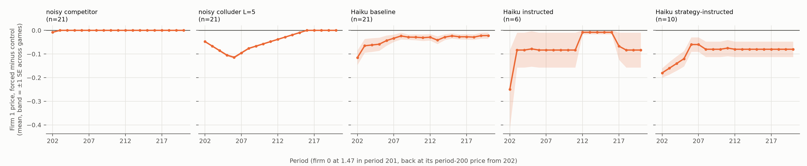
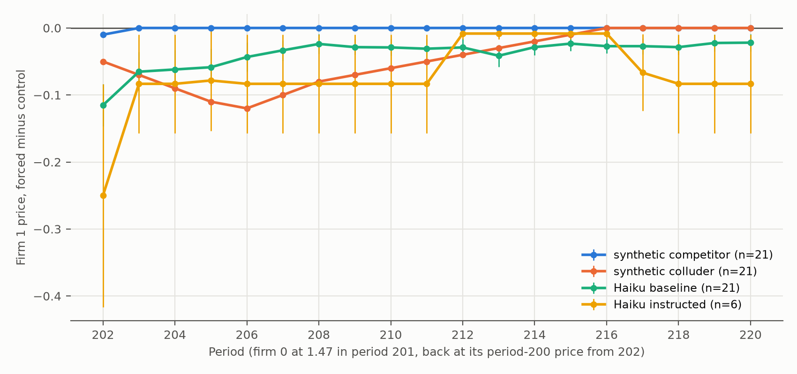

# Follow-up studies (2026-10-24)

# Second follow-up: LLM colluder, noisy synthetic agents, exploratory BR comparison

Pre-registered in CLAUDE.md (commit `e663996`), designed after the follow-up and noise-fork results.
Spend for (f): $6.93 for the 10 games (6,005 calls, 0 parse failures) and $0.51 for their hold-back fork,
**$7.44** of the $9 cap. (g) and (h) cost nothing. Files: `main_table.csv`, `strategy_*.csv`, `noisy_*.csv`,
`exploratory_br_position.csv`, `fig7_holdback_mean_D_panels.png`.

## Main table

Fish δ and naive δ: pooled real vs 1,000 re-pairings within the same row (one-sided p), and per-pair AUROC
real vs placebo. "n.i." counts real pairs whose δ can't be estimated (no price movement in the window).
Hold-back categories use the committed rules (CLAUDE.md, Follow-up (d)).

| Row | Fish δ real / placebo | Fish p, AUROC (n.i.) | Naive δ real / placebo | Naive p, AUROC | No reaction | Matching | Punish-and-return | Persistent | Other | Compliant |
|---|---|---|---|---|---|---|---|---|---|---|
| Synthetic competitor, noisy (21) | **0.149** / −0.003 | **0.001**, 0.60 (11/21) | 0.145 / 0.040 | 0.001, 0.67 | 21 | 0 | 0 | 0 | 0 | — |
| Synthetic colluder, noisy, L = 5 (21) | −0.013 / −0.004 | **0.93**, 0.53 (9/21) | 0.017 / −0.002 | 0.026, 0.55 | 1 | 0 | **20** | 0 | 0 | — |
| Haiku baseline (21) | 0.086 / 0.005 | 0.001, 0.71 (4/21) | 0.033 / 0.003 | 0.001, 0.74 | 5 | 7 | 1 | 6 | 2 | — |
| Haiku instructed (6) | n.i. | 0.79, 0.48 (6/6) | 0.006 / 0.000 | 0.033, 0.42 | 3 | 1 | 0 | 2 | 0 | — |
| Haiku strategy-instructed (10) | **0.465** / 0.000 | 0.001, 0.56 (7/10) | 0.347 / −0.002 | 0.001, 0.79 | 1 | 2 | 3 | **4** | 0 | **6/10** |

Colluder punishment-length sweep (noisy, 21 games each, same q):

| L | Fish δ real / placebo, p | Naive δ p | No reaction | Punish-and-return | Persistent |
|---|---|---|---|---|---|
| 1 | −0.040 / −0.000, 1.00 | 0.47 | 1 | 20 | 0 |
| 3 | −0.007 / −0.004, 0.85 | 0.001 | 1 | 20 | 0 |
| 5 | −0.013 / −0.004, 0.93 | 0.026 | 1 | 20 | 0 |
| 10 | −0.016 / −0.002, 0.95 | 0.86 | 1 | 0 | **20** |

## What it shows

- **Fish δ measures reaction, not collusion.** It flags the noisy competitor, a myopic seller that just
  follows its rival's price (δ = 0.149, p = 0.001). It misses the noisy colluder at every punishment length
  (p = 0.85–1.00). It does detect the LLM colluder (δ = 0.465, p = 0.001), because the few price changes
  those games have are punishment episodes. Even there, 7 of 10 games are too frozen for a per-pair δ.
- **The hold-back fork identifies short punishments, not long ones.** The noisy colluder comes out
  punish-and-return for L = 1, 3 and 5 (20/21 each), but **persistent** for L = 10 (20/21). A 10-period
  punishment plus the climb back doesn't fit in the 19-period window. So "persistent" does not mean "not collusive".
- **An LLM told the exact strategy follows it only in part.** In the hold-back fork, 9 of 10
  strategy-instructed firms cut by exactly 0.20 right after the one-period undercut, as instructed. Only 6 of
  10 were back within 0.02 of the control price by period 212 (compliant 6/10). 3 games cut for 4 periods
  (202–205) and returned in 206, one period short of the instructed 5. **4 of 10 stayed cut to period 220**
  (strategy_instructed_001, 002, 009, and 010, which returned in 205 and cut again). The one non-reactor
  (008) already priced at 1.50, so 1.47 wasn't an undercut by more than 0.05.
- **That reframes the Haiku baseline result.** In the baseline, 8 of 27 hold-back games were persistent.
  Explicit LLM colluders end up persistent just as often (4/10), so persistence can't separate an unreturned
  punishment from a lasting price drop.
- **Strategy-instructed games freeze too.** A firm changes price in 1.8% of periods 101–300. 3 of 20
  firms pass the 10-change cutoff, and 1 of 10 games has both firms passing it. Median Δ = 1.03: 6 of 10
  games sit above the monopoly price (Δ 1.01–2.27), and 4 sit at 0.06–0.39.
- **Cross-game diagnostic, strategy-instructed:** periods 1–100 first-difference correlation 0.06 (firm 0)
  and 0.28 (firm 1). In periods 101–300, 42 of 45 firm-0 pairs and 39 of 45 firm-1 pairs are undefined
  because at least one seller never changes price.

## Noisy synthetic agents: calibration (`noisy_calibration.json`)

- Target: the Haiku baseline change share over periods 101–300, 0.0482.
- q was calibrated on 210 games: **q = 0.0027** (competitor), **0.0031** (colluder, L = 5). Calibration
  shares were 0.0487 and 0.0486.
- The final 21-game samples still differ from the target: competitor 0.084; colluder 0.023 (L = 1), 0.030
  (L = 3), 0.034 (L = 5), 0.041 (L = 10). A tremble is rare, and one tremble sets off a run of follow-up
  changes, so 21-game samples vary a lot.
- First attempt, with q calibrated on only 21 games (q = 0.0035 / 0.0027): final shares 0.071 / 0.026.
  The same conclusions hold under both: competitor flagged by Fish δ (0.071, p = 0.001); colluder missed at
  every L; hold-back 20/21 punish-and-return for L = 1, 3, 5 and 20/21 persistent for L = 10.

## Exploratory (not pre-registered as a test): where firm 1 ends up (`exploratory_br_position.csv`)

Firm 1's period-220 price vs its best response to firm 0's period-200 price, ±0.02:
- All 27 Haiku hold-back games, control branch: 17 above, 8 at, 2 below the best response.
- The 8 persistent games: all 8 above it in the control branch. In the forced branch, 4 end **at** it
  (baseline_002, 005, 008, 014) and 4 stay above it.
- So in half the persistent games, one undercut moved firm 1 from a supracompetitive price to the
  competitive (best-response) price, and it stayed there.

# First follow-up: hold-back fork, synthetic known-answer agents, instructed-only placebo

Pre-registered in CLAUDE.md (commit `2384f37`), designed after seeing the first fork results.
Hold-back classification rules were fixed on synthetic agents only and committed (`f3ce733`) before any
Haiku hold-back result was read. Haiku hold-back fork: 54 branches, 1,080 firm-1 calls, 0 parse failures,
cost $1.47 (cap $5). Files: `synthetic_*.csv`, `haiku_holdback_*.csv`, `fig6_holdback_mean_D.png`.
(`main_table.csv` now holds the second follow-up's table above.)

## First follow-up table

Fish δ and naive δ: pooled real vs 1,000 re-pairings within the same row (p one-sided), and per-pair AUROC
real vs placebo. "Not identified" = the pair's prices don't move in the regression window.
Hold-back: firm 0 at 1.47 for one period (201), then back at its own period-200 price; categories from
D(t) = firm 1 forced minus control, t = 202–220 (rules in CLAUDE.md, Follow-up (d)).

| Row | Fish δ real / placebo mean | Fish p, AUROC | Naive δ real / placebo mean | Naive p, AUROC | No reaction | Matching | Punish-and-return | Persistent | Other |
|---|---|---|---|---|---|---|---|---|---|
| Synthetic competitor (21) | not identified (21/21 frozen) | —, 0.50 | 0.028 / 0.014 | 0.042, 0.65 | 21 | 0 | 0 | 0 | 0 |
| Synthetic colluder (21) | not identified (21/21 frozen) | —, 0.50 | 0.070 / 0.002 | 0.15, 0.50 | 0 | 0 | **21** | 0 | 0 |
| Synthetic competitor, shocked (21; hold-back only) | — | — | — | — | 0 | **21** | 0 | 0 | 0 |
| Haiku baseline (21) | 0.086 / 0.005 | 0.001, 0.71 | 0.033 / 0.003 | 0.001, 0.74 | 5 | 7 | **1** | 6 | 2 |
| Haiku instructed (6; instructed-only placebo) | not identified (6/6 frozen) | 0.79, 0.48 | 0.006 / 0.000 | 0.033, 0.42 | 3 | 1 | **0** | 2 | 0 |

## What it shows

- **On-path δ tests are blind to a known colluder that holds its price.** The synthetic colluder runs a
  true reward–punishment strategy, but it never deviates on path, so Fish δ has nothing to estimate (21/21),
  and naive δ doesn't beat its placebo (p = 0.15, AUROC 0.50). The Haiku instructed games look the same:
  Fish δ is not identified in 6/6.
- **The hold-back fork separates the known agents.** Colluder: 21/21 punish-and-return, cutting to −0.12
  for 5 periods and returning by period 215–216. Competitor: no reaction (it already sits at 1.48, so the
  cut is one cent). A competitor facing a real cut: 21/21 matching, a 2–3 cent dip gone by period 204.
- **Haiku firms mostly ignore or briefly match a one-period cut.** Among 21 baseline games: 5 no reaction,
  7 matching (often a one-period drop of 0.10–0.27, back the next period), and only 1 punish-and-return
  (baseline_016: −0.24 for 4 periods, back by 206). Instructed: 0 of 6 punish-and-return.
- **But 8 of 27 Haiku games drop and stay down.** 6 baseline and 2 instructed games are persistent: firm 1
  is still lower at period 220 although firm 0 returned to its old price in period 202. Sizes range
  from −0.05 to −0.16 at period 220 (instructed_003: −0.45). That is not the reward–punishment signature,
  which needs a return.
- **Firm 1 almost never goes below the Nash price (1.47).** Share of periods 202–220 below 1.47, mean over
  baseline games: 0.20 forced vs 0.18 control. Nearly all of it is in 4 games that already priced at
  1.43–1.47 before the fork (baseline_001, 009, 010, 012). Elsewhere: one period in baseline_004 and
  baseline_007, three in baseline_008 (forced branch only). Instructed: 0 in both branches.
- **Instructed-only placebo:** re-pairing instructed firms across the 6 instructed games gives the same
  high prices. Per-pair price-level AUROC, real vs placebo: 0.48 [0.35, 0.64] (6 real, 30 placebo pairs).
  The high level reflects each firm following its own instruction, not anything the pair does together.

## Caveats

- The hold-back rules have a thin margin against a sluggish myopic responder (CLAUDE.md, Follow-up (d)).
  The one Haiku punish-and-return game has a deep cut (−0.24), which counts against that explanation.
- Forced and control branches are sampled separately. The control-vs-control fork below measures how much
  of the hold-back result that noise could explain.

## Control-vs-control fork: branch noise (CLAUDE.md, Follow-up (e))

Pre-registered (`01ddece`) after the hold-back results. A second control branch (control2) per game,
identical to the control: 27 branches, 540 firm-1 calls, 0 parse failures, $0.73 (cap $3).
Files: `noise_per_game.csv`, `noise_threshold.json`.

- **Noise at period 220 is small.** N(220) = control2 minus control is 0.00 in 24 of 27 games, 0.01 in two,
  and +0.16 in one (baseline_008, upward). Threshold T = 95th percentile of |N(220)| = **0.01**.
- **All 8 persistent games survive.** Each has D(220) < −0.01 (−0.05 to −0.45), and all 8 are still
  persistent when re-classified against control2 instead of control.
- **Noise alone never produces "persistent" or "punish-and-return".** Classifying control2 vs control with
  the same rules gives 23 no reaction, 1 matching and 3 other: those two categories are partly noise.
- **Re-classified against control2:** persistent 8 → 8, punish-and-return 1 → 1 (baseline_016),
  matching 8 → 7 (baseline_001 becomes no reaction), other 2 → 1 (baseline_015 becomes no reaction;
  baseline_009 stays "other" but shows the same dip in the noise fork, so it is noise).
- So the robust Haiku hold-back result is: 8 of 27 games drop and stay down, 1 of 27 punishes and
  returns, and the remaining "matching"/"other" counts include about 1 in 6 games' worth of branch noise.
- Synthetic agents are deterministic. With noise only in their starting prices, they freeze by period 100,
  which is why Fish δ can't be estimated for them.
